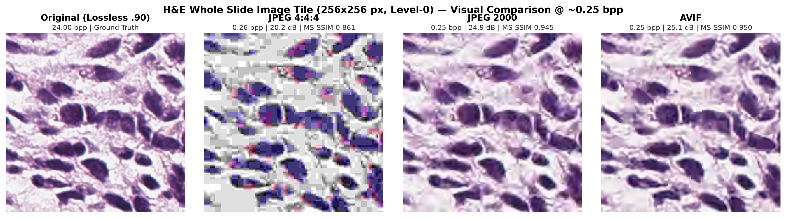
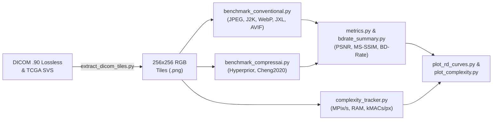

# Whole Slide Image (WSI) Compression Benchmark

A modular Rate-Distortion (R-D) and Computational Complexity benchmarking suite for evaluating **conventional image codecs** (`JPEG`, `JPEG 2000`, `WebP`, `JPEG XL`, `AVIF`) and **learned neural compression models** (`CompressAI`) on histopathology Whole Slide Images (H&E).



---

## 1. Objective & Motivation

* **The Problem:** Most public digital pathology repositories (e.g., TCGA) store slides that are already pre-compressed by clinical scanners (`JPEG Q=70–80`, $\approx 0.28\text{ bpp}$). Using pre-compressed data as ground truth introduces **Generation Loss Bias** (missing high-frequency chromatin details and artificially inflated PSNR/MS-SSIM scores).
* **The Solution:** This pipeline establishes an unbiased benchmark using **verified lossless Level-0 WSI ground truth** from the NCI Imaging Data Commons (DICOM Transfer Syntax `.90` / JPEG 2000 Lossless) and compares it against scanner pre-compressed cohorts.
* ** Evaluation Scope:** Standardized comparison across bitrate (`bpp`), fidelity (`RGB-PSNR`, `MS-SSIM`), Bjøntegaard-Delta (`BD-Rate`), and hardware complexity (`MPix/s`, `MParams`, `kMACs/px`).

---

## 2. Pipeline Architecture



---

## 3. Code Overview (`example_usage/`)

| Script | Description |
| :--- | :--- |
| **`download_one_rms.py`** | Queries NCI IDC (`idc-index`) and downloads verified lossless H&E DICOM slides (`.90`). |
| **`extract_dicom_tiles.py`** | Extracts non-overlapping $256 \times 256$ Level-0 tissue tiles via `OpenSlide` (filtering out glass background). |
| **`tiles.py`** | Loads PNG/TIFF tiles as `uint8` RGB arrays or generates synthetic H&E test tiles. |
| **`metrics.py`** | Computes `bits_per_pixel`, pooled `psnr_rgb`, and 5-scale `ms_ssim_rgb` (`numpy`-only). |
| **`benchmark_conventional.py`** | Bisects codec parameters to match target bitrates ($0.12\text{–}1.50\text{ bpp}$) across all 6 conventional codecs. |
| **`benchmark_compressai.py`** | Evaluates pretrained CompressAI models (`bmshj2018-hyperprior`, `cheng2020-attn`) using real rANS entropy coding. |
| **`complexity_tracker.py`** | Profiles single-pass encoding/decoding throughput ($\text{MPix/s}$), peak RAM, model parameters, and $\text{kMACs/px}$. |
| **`bdrate_summary.py`** | Calculates ITU-T VCEG-M33 **BD-Rate (%)** and **BD-PSNR (dB)** relative to `JPEG 4:4:4`. |
| **`plot_rd_curves*.py`** | Plots R-D curves (`plot_rd_curves.py`, `plot_rd_curves_tcga.py`, `merge_plots.py`). |
| **`plot_complexity.py`** | Generates log-scale throughput bar charts and Pareto front scatter plots. |

---

## 4. Quickstart

```bash
# 1. Install dependencies
pip install numpy pandas matplotlib Pillow imagecodecs torch torchvision compressai openslide-python idc-index

# 2. Run benchmarks on extracted 256x256 tiles
cd example_usage
python benchmark_conventional.py --tiles-dir tiles_rms_lossless_256 --out results_rms_conv.csv
python benchmark_compressai.py --tiles-dir tiles_rms_lossless_256 --out results_rms_ai.csv

# 3. Generate plots, complexity metrics, and BD-Rate summary
python plot_rd_curves.py
python complexity_tracker.py --tiles-dir tiles_rms_lossless_256 --limit 3
python plot_complexity.py
python bdrate_summary.py
```

---

## 5. Contact & Bug Reports

If you encounter any bugs, reproducibility issues, or have questions regarding the benchmark setup, please **open an issue** in this repository or **send me an email** at [leonard.saghyan@rwth-aachen.de](mailto:leonard.saghyan@rwth-aachen.de) , I will gladly look into it!
